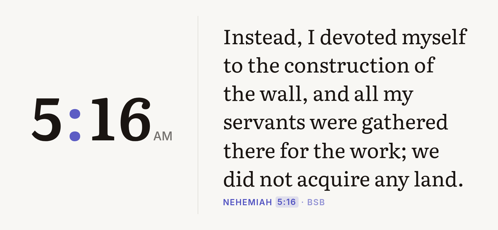
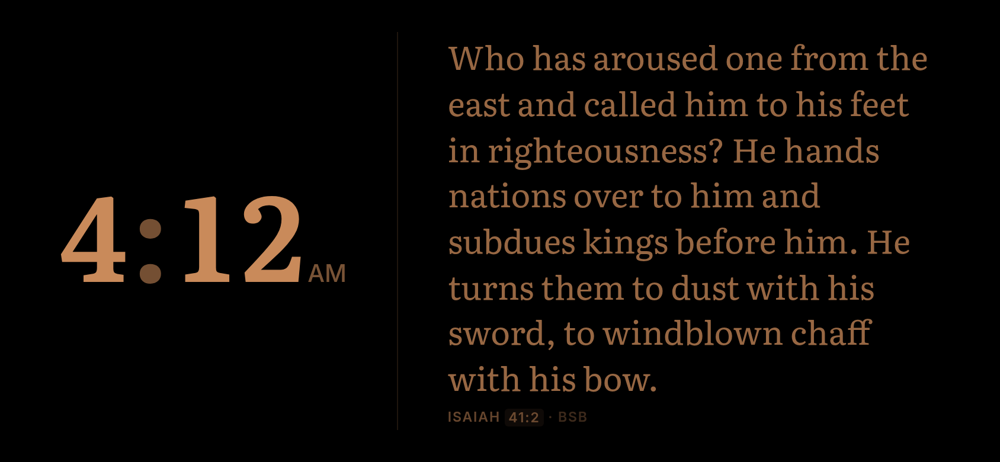
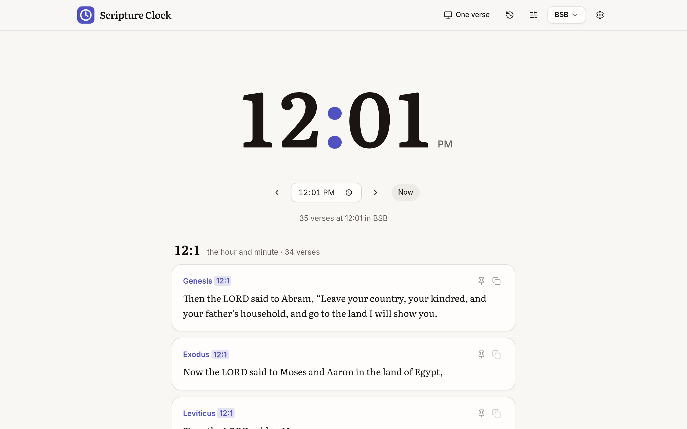

# Scripture Clock

The verses whose chapter and verse match the time on the clock.

**Use it: [mastertemple.github.io/scripture-clock](https://mastertemple.github.io/scripture-clock/)**

<p align="center">
  
  
</p>
<p align="center">
  
  
</p>

At **5:48** it shows every chapter 5, verse 48 in the Bible (Matthew 5:48, …), then the clock's digits read another way: **54:8** (Isaiah 54:8). At 12:01, as well as 12:1, there's Psalm 120:1.

- **Live**: the verses change as each minute turns; the next minute's books download ahead of time.
- **Any time**: step a minute at a time (← →, Shift for an hour), or pick a time. The URL keeps it (`#17:48`) so a time can be shared; Esc comes back to now.
- **12- or 24-hour**: 5:48 PM is chapter 5 on a 12-hour clock, chapter 17 on a 24-hour one (which also finds 1:748 and 174:8, should a chapter ever be that long).
- **Other readings** can be turned off, to see only hour:minute.
- **Seconds**, as large as the hour and minute (off at first).
- **Keep screen on**, for a clock left on a desk or nightstand.

## One verse at a time

The app opens to one verse picked at random from the minute's verses, full screen, with a new one each minute. **All** switches to every verse at the time (and the app opens to whichever you left it on; `?display` or `?list` in the URL, or a long press on the installed app's icon, opens one or the other). Swipe left (or press → or Space) for another, and right (←) to go back through what was shown, into earlier minutes too, with a **Now** button to return (it returns on its own after a minute). Tap to show or hide the controls.

**Verses per minute** (in the layout menu or Settings; 1 at first) moves on partway through the minute: at 2 a minute each verse shows for 30 seconds, changing at :00 and :30, with a thin line along the bottom showing how long is left. Any number that divides a minute evenly, up to 60.

**Verses at once** (in the layout menu, in Settings, or with + and −) shows more than one, 1 to 8, each with its reference, all sized together to fill the space; swiping goes on to the next ones. **Seconds** (off at first) show as large as the hour and minute, in both views.

| Layout | |
| --- | --- |
| **Auto** (default) | Landscape when the screen is wider than tall, portrait otherwise |
| **Landscape** | The clock beside the verse, for a phone turned sideways |
| **Portrait** | The clock above the verse |
| **Verse** | The verse as large as it fits, with a small clock in the corner |
| **Night** | Dim amber on black, for a dark room |

The verse's text is sized to fill the space, from a few words to Esther 8:9. Full screen (F) on Android also turns the phone to landscape for the Landscape layout; iPhones have no full-screen for pages, but the app added to the Home Screen opens without Safari's bars. The screen stays on while the display is open.

## Your verses

**Pinned** (the sliders button): pin any verse or passage to a time, e.g. `Heb 4:12` at 4:12 (the time fills in from the reference). At that time the one-verse display shows it before anything else, and the list shows it at the top. Pin several to one time (`Heb 4:12; Prov 4:12`) and they take turns. The pin button on a verse pins it to the time it's showing at. On a 12-hour clock a pin at 4:12 is for both 4:12s; `16:12` is for the evening only.

**History**: every verse the display shows is kept on this device (up to 2,000 screens; it can be turned off, or cleared). Search it by words, a book (`rom`), or a reference (`Ps 23`, which finds the verses in it, pinned passages too), and filter it by day, week, month, translation, or pinned verses. A verse there can be copied or pinned to the time it was shown at.

**Books**: how often the display picks from each book, set by testament, by section (Law, History, Gospels & Acts, Paul's Letters…), or book by book: Never, Less, Normal, More, Most, each about three times as likely as the one below. Never also hides a book from the list.

## Bibles

The same as [Scripture Hash](https://github.com/MasterTemple/scripture-hash):

- **Built in**: BSB, KJV, WEB, ASV, LSV, and YLT, each book downloaded from [fetch.bible](https://fetch.bible) when first needed and kept in IndexedDB.
- **Browse more**: fetch.bible's ~1,400 translations.
- **Upload your own**: a `.zip` of a whole Bible in USFM or USX, an OSIS file, or single `.usfm`/`.sfm`/`.usx` books. Read on your device and never uploaded.

Which verses exist at a time comes from [topos-bible](https://www.npmjs.com/package/topos-bible)'s verse counts (its default versification), so nothing has to download to know them. A verse the chosen translation doesn't have is listed under the group as "Not in …".

## How it's built

React 19, TypeScript, Vite, Tailwind CSS v4, Radix, and zustand, with:

- `src/clock/times.ts`: a time's readings and the verses for each
- `src/bible/`: shared with Scripture Hash: [logoxide](https://www.npmjs.com/package/logoxide) reads USFM/USX/OSIS in a Web Worker; topos-bible names books and counts verses
- [vite-plugin-pwa](https://vite-pwa-org.netlify.app): installable, and works offline for the books already downloaded

```bash
npm install
npm run dev        # http://localhost:5173 (and on your network)
npm test
npm run build      # static site in dist/
```

Each push to `main` tests, builds, and deploys to GitHub Pages (`.github/workflows/deploy.yml`). In the repository's settings, set **Pages → Source** to **GitHub Actions**.
